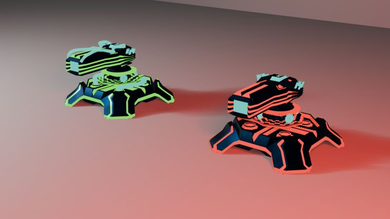
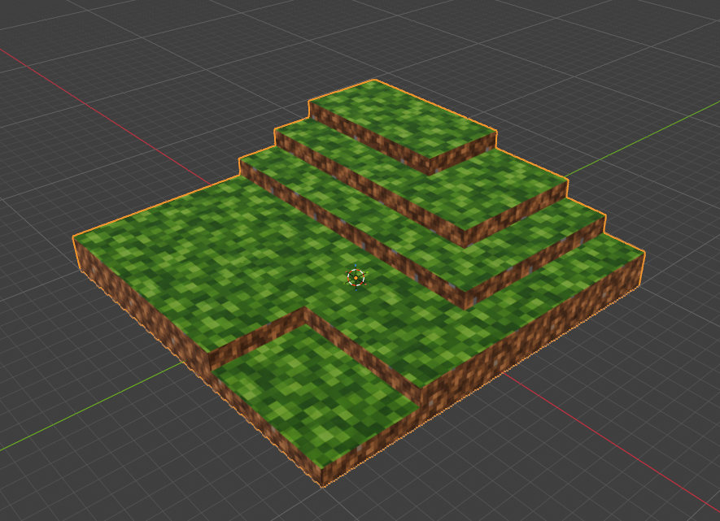
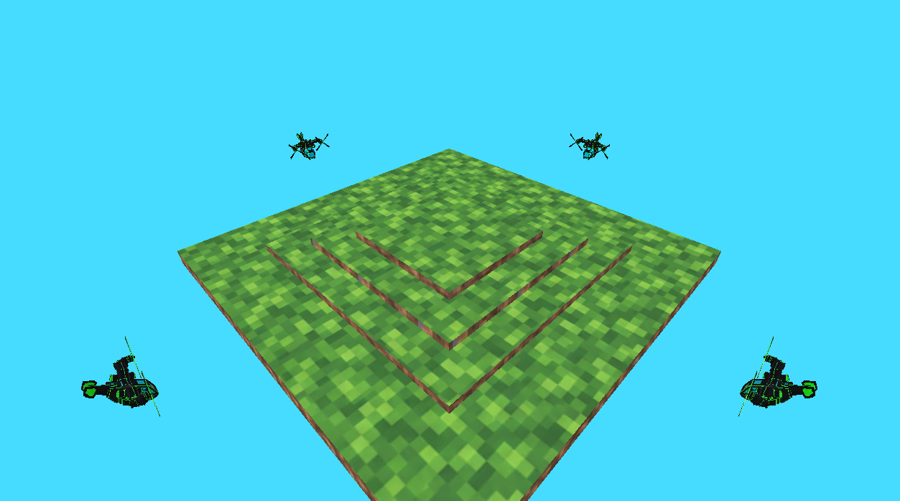
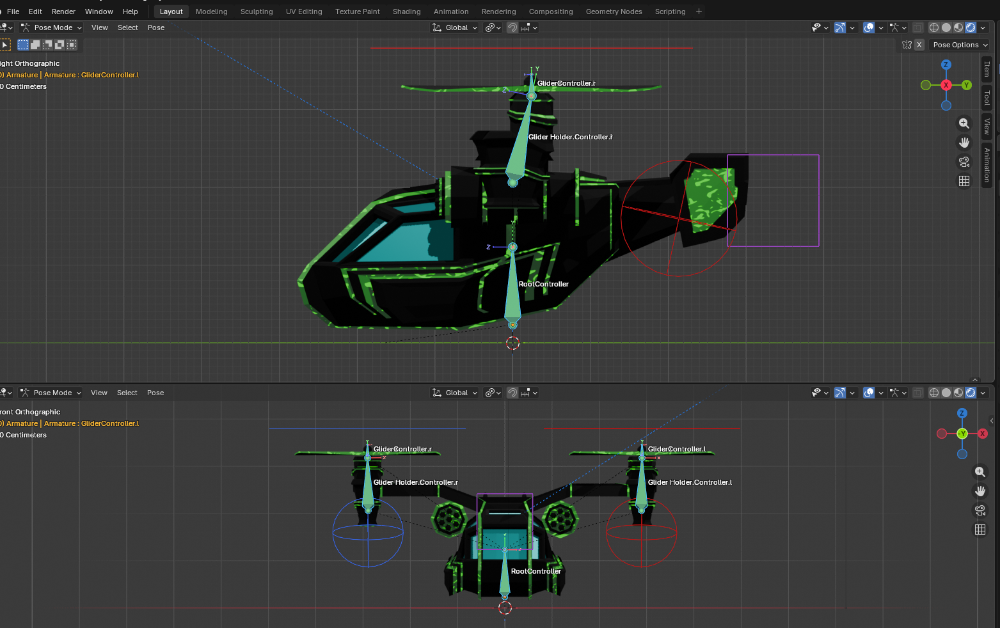
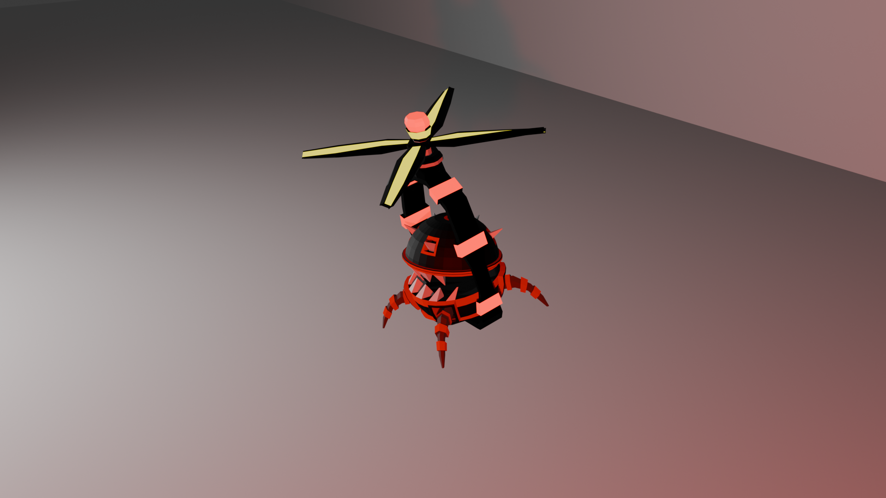
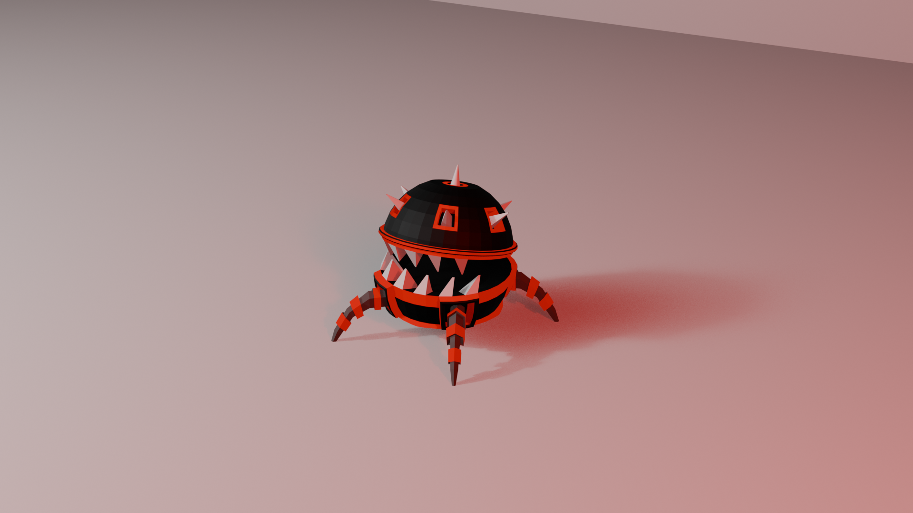
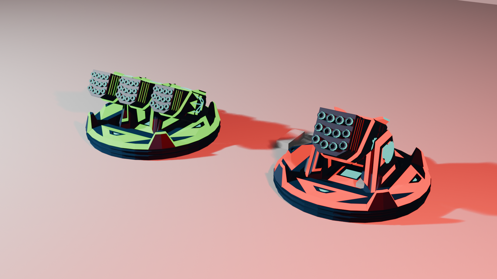
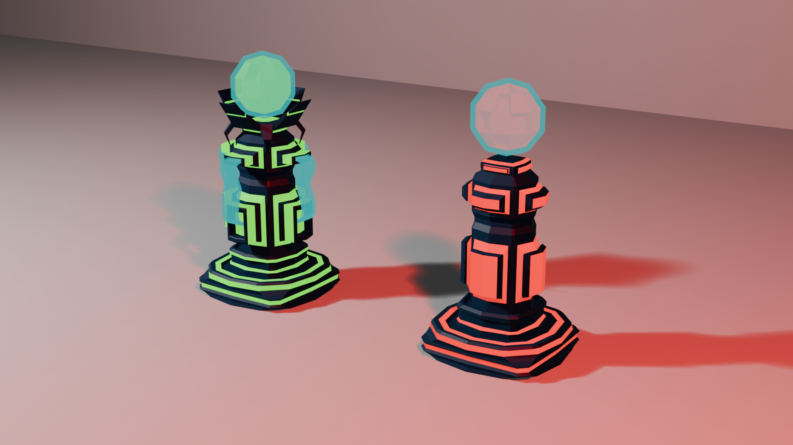

# Tower Defence — Unity Gameplay and Original 3D Art

**Benyamin (Billy) Rahmantalab · Unity Game Developer & 3D Game Artist**

I am developing this tower defence game in Unity and creating its 3D assets in Blender. This public showcase brings together selected C# gameplay code and the tower and Base artwork I made for an **in-development prototype**. The main game repository remains private.

*My Blender render of two tower upgrade variants. This shows game assets, not a gameplay screenshot. [View the tower artwork post](https://www.linkedin.com/feed/update/urn:li:activity:7503443533014519808/).*

**Unity 6000.2.2f1 · C# · Blender · URP · AI Navigation**

[Contact me on LinkedIn](https://www.linkedin.com/in/benyamin-rahmantalab-650675394/)

## Project visuals

These images show work in progress: Blender models and renders, plus a Unity scene capture. They are not screenshots of a finished game.

| Environment in Blender | Environment in Unity |
| --- | --- |
|  |  |

| Helicopter rig in Blender | Flying enemy render |
| --- | --- |
|  |  |

| Ground enemy | Rocket tower variants |
| --- | --- |
|  |  |

| Laser gun variants | Laser tower variants |
| --- | --- |
|  |  |

## My Blender game art

I designed, modeled, and animated the tower assets shown below. I also modeled and rigged the helicopter Base, created its landing animations, and built its procedural materials. The linked posts show the actual artwork.

| Project work | What it demonstrates | View |
| --- | --- | --- |
| Tower designs and upgrade variants | Modeling, animation, and readable visual progression for machine gun, laser, and rocket towers | [Tower showcase](https://www.linkedin.com/feed/update/urn:li:activity:7503443533014519808/) |
| Helicopter Base | Blender modeling, rigging, landing animations, and procedural materials | [Helicopter showcase](https://www.linkedin.com/feed/update/urn:li:activity:7513184259763785728/) |

## My Unity and C# work

- **Modular towers:** targeting, weapon cadence, attack execution, aiming, visuals, and progression have separate responsibilities.
- **Owner-specific progression:** upgrades are keyed by owner and tower type, so an upgrade can synchronize that owner's existing towers and initialize later towers at the same level.
- **Explicit match outcomes:** a C# state model collects commands for a simulation tick, applies eliminations before arrivals, and locks the final winner or draw before notifying listeners.
- **NavMesh navigation:** enemies select reachable registered targets, spread their first queries over time, and limit path checks per target refresh.
- **Grid authoring:** logical occupancy and cached terrain heights support tower and road placement; Editor tooling lets the developer author Base and Destination footprints.
- **Enemy spawning foundation:** cached NavMesh triangles supply candidate positions; bounded clearance and target-reachability checks precede pooled spawning.

These describe code present in the development workspace. They are not claims of a completed game, validated mobile capacity, or a shipped release.

## Review the code

| Sample | Engineering focus |
| --- | --- |
| [MatchFlowState.cs](samples/MatchFlowState.cs) | State transitions, batched commands, immutable result snapshots, callback guards |
| [TowerProgressionIdentity.cs](samples/TowerProgressionIdentity.cs) | Value-based owner/type identity and composite dictionary keys |
| [TowerProgressionService.cs](samples/TowerProgressionService.cs) | Group registration, shared upgrade state, lifecycle and callback handling |
| [EnemyNavMeshMovement.cs](samples/EnemyNavMeshMovement.cs) | Bounded path selection, target refresh timing, agent lifecycle |

Start with [the code sample guide](samples/README.md), then [the architecture notes](docs/architecture.md).

The samples are unchanged copies of selected project files. The Unity-dependent samples reference systems from the private project and are provided for code review, not as a complete Unity package.

## Gameplay direction

The planned match has **one player and three AI factions**, each with a Base. Towers defend while roads support a damageable Package's delivery to a shared Destination. The first eligible delivery wins; destroying a Base eliminates its faction. Enemies use NavMesh rather than roads.

The full delivery loop, XP and random level-up offers, AI decision behavior, complete map integration, and final presentation remain development work. No playable build is included in this showcase.

## My role

I work on both sides of this game: original Blender assets and Unity gameplay code. The artwork links document the tower and Base models I created; the C# samples show part of the implementation. The complete game is still in development.

**Available for freelance Unity development, playable prototypes, and Blender game art.**

## Snapshot

Prepared on **13 October 2026** from the current local development workspace. The original game repository remains private. This separate showcase includes no game scenes, prefabs, models, textures, development logs, or repository history.

No Unity compilation, automated test, Play Mode run, build, or device benchmark was executed while preparing this showcase. The target of approximately 1,000 enemies is a future profiling objective, not a measured result.
