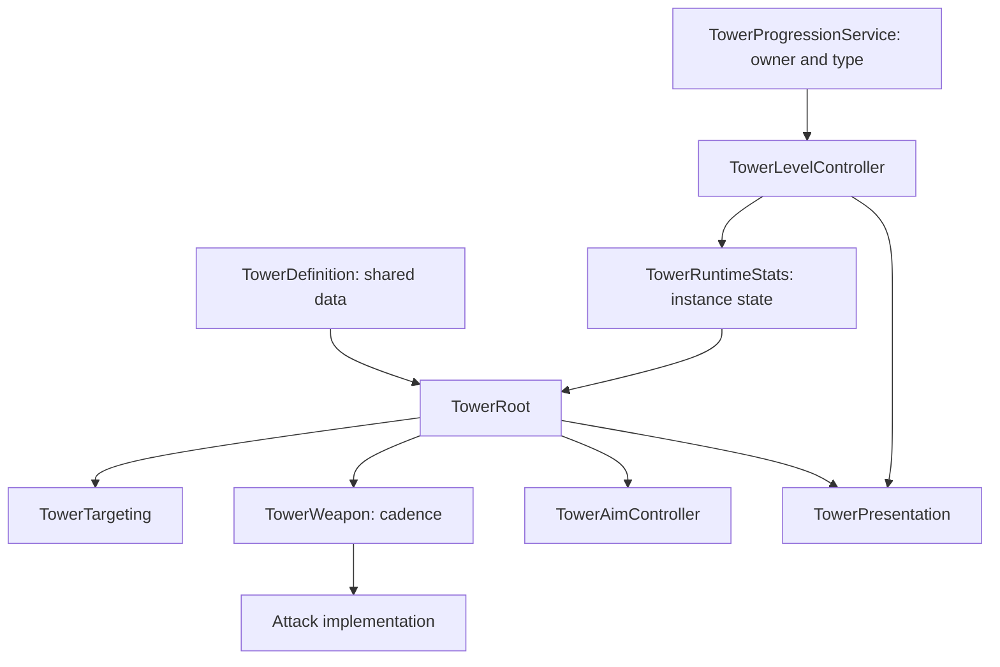

# Architecture notes

## Tower composition

The tower facade coordinates specialized modules. Shared authored data lives in `TowerDefinition`, while mutable per-instance combat values live in `TowerRuntimeStats`.

Targeting uses interval-based, layer-filtered physics queries. Attack execution and animation speed have separate responsibilities. Group progression uses registered tower membership rather than searching a scene for every upgrade.

## Match authority

Faction identity and match outcome policy are separate concerns. `MatchFlowState` receives explicit owner/tick commands and resolves them at a boundary supplied by its caller. It neither polls HP nor decides how a Package travels.

For one tick:

1. Producers submit elimination and arrival commands.
2. The coordinator closes the tick with `ResolveTick`.
3. Eliminations commit first.
4. Only surviving owners' arrivals can determine the result.
5. A terminal result is locked before notifications dispatch.

This prevents same-tick arrival/elimination results from depending on command submission order.

## Map and navigation

`GridMap` keeps placement state and sampled surface heights in logical cells. Road connections are data; mesh selection is presentation. Base and Destination authoring use 2×2 footprints. Towers and road pieces use individual cells.

The current NavMesh enemy mover uses registered target markers, timed target refreshes, distance ordering, and bounded path checks. A separate spawner samples cached NavMesh triangles and rejects obstructed or target-unreachable candidates before requesting a pooled enemy.

The old road-following enemy prototype belongs to a previous design. It is not the intended production enemy navigation. Roads are intended for Package delivery.

## Development boundary

This is a development snapshot. Source-level components exist, but a complete integrated match, enemy combat/health integration, delivery behavior, level-up flow, AI decisions, and mobile profiling remain ongoing work. Scene wiring and device measurements are necessary before claiming those outcomes.

No gameplay system was changed for this showcase.
